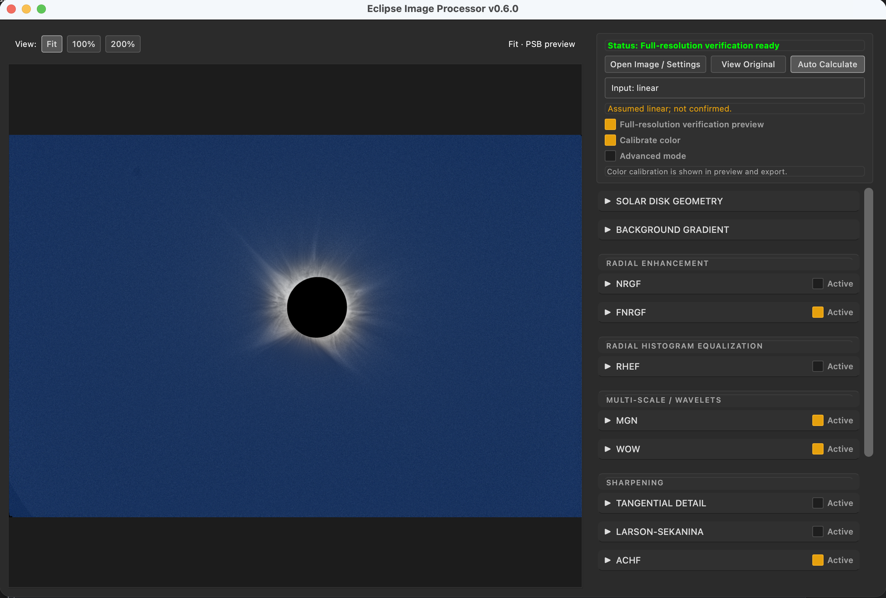
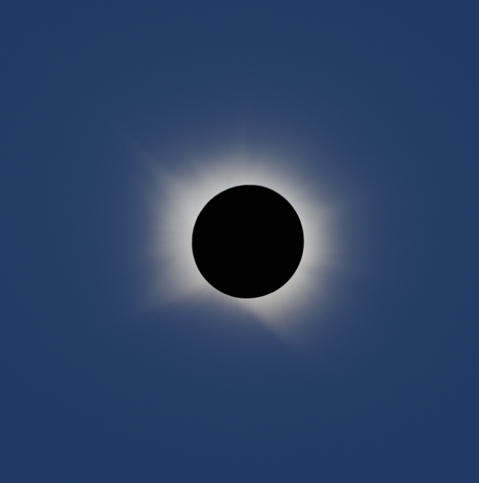
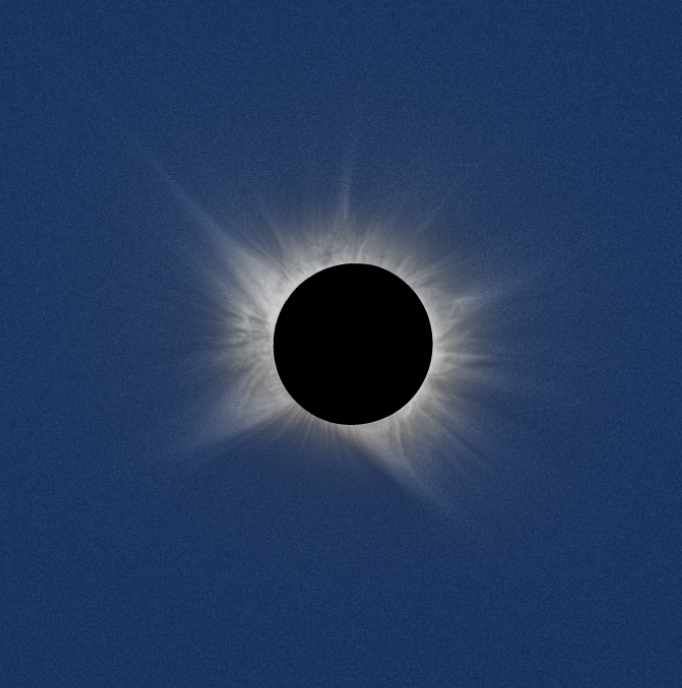
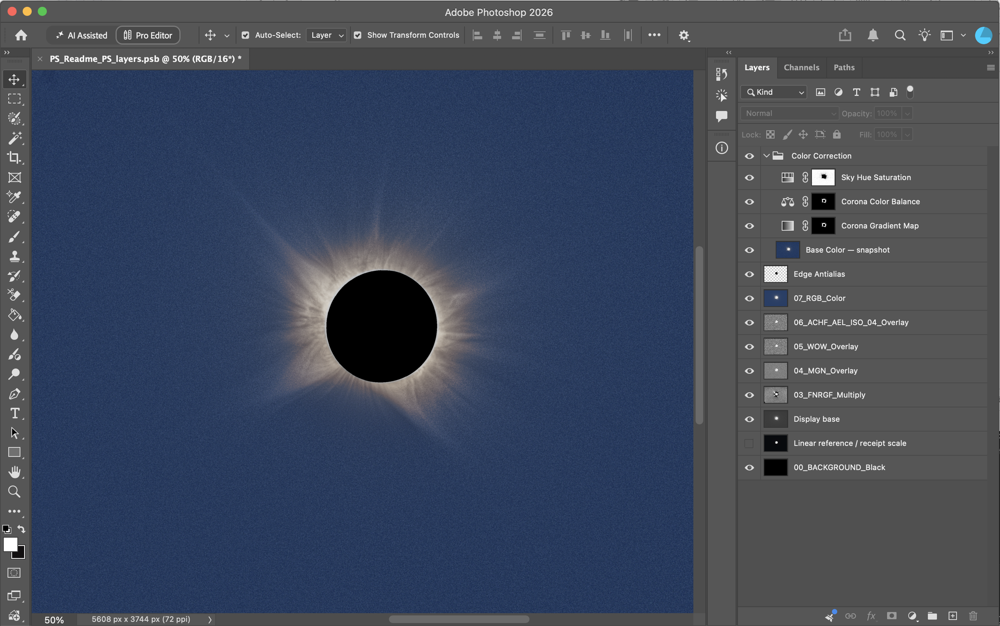

# Eclipse Image Processor

**Version 0.6.0 · Francisco Bitto**
[Source and issues](https://github.com/fbitto/Eclipse-Image-Processor) · [MIT license](LICENSE)

A Python/PySide6 desktop application for enhancing solar-eclipse corona images. Preview, full-resolution verification and export share independent filter layers and Photoshop blend modes. These are visualization products, not calibrated brightness measurements.



*Full-resolution verification with independent filter layers.*

## Install and launch

Use **Python 3.14 or later**, with the dependencies available for your platform. From the project directory:

```bash
python3 -m venv .venv
source .venv/bin/activate
python -m pip install -r requirements.txt
python main.py
```

On Windows, use `python` to create the environment and activate it with `.venv\Scripts\Activate.ps1`. For a macOS app or DMG, see [build instructions](docs/build-macos.md). Local builds are not a notarized public release.

Dependencies: PySide6 (GUI), NumPy/SciPy (numerical processing), OpenCV/Pillow (image handling), Astropy/xisf (astronomical input), tifffile (TIFF), watroo 0.0.4 (WOW), and psd-tools 1.26.0 (PSB). Install the pinned requirements; the PSB writer relies on the specified low-level API. Keep `requirements.txt` and the inline metadata in `main.py` synchronized.

## Build a standalone application

Build on the target operating system; PyInstaller does not cross-compile these packages. Install the build dependencies in the same environment as the runtime dependencies.

**macOS (Terminal):**

```bash
.venv/bin/python -m pip install -r requirements.txt -r requirements-build.txt
.venv/bin/python scripts/build_macos.py --dmg
```

Output: `dist/Eclipse Image Processor.app` and `.dmg`. Omit `--dmg` for just the app. The build uses `assets/Eclipse_Image_Processor.icns` for Finder/Dock and the matching PNG for Qt and the menu-bar icon. Architecture follows the Python interpreter. See [macOS build details](docs/build-macos.md).

**Windows (PowerShell):**

```powershell
.venv\Scripts\python.exe -m pip install -r requirements.txt -r requirements-build.txt
.venv\Scripts\python.exe scripts/build_windows.py
```

Output: `dist\Eclipse Image Processor\Eclipse Image Processor.exe`. Distribute the **whole application folder**, including `_internal`. The build embeds `assets/Eclipse_Image_Processor.ico` and version metadata; Qt uses that ICO for the window/taskbar and the matching PNG for the notification-area icon. See [Windows build details](docs/build-windows.md).

The menu-bar/notification-area icon appears when the desktop supports a system tray. Local builds are unsigned or ad-hoc signed; public signing/notarization is a separate release step. Both builders use `config.APP_VERSION` and include third-party license notices. Rebuild to update an existing package's icon or version.

## Process an image

1. **Open Image / Settings:** open TIFF, FITS, XISF, PNG, JPEG or BMP, or reopen a settings JSON. Prefer an original linear image. **Input: linear** is an assumption you must check; choosing another input state does not undo a previous stretch.
2. **Check disk geometry:** inspect the red circle and adjust Center X, Center Y and Radius in original-image pixels. Use **Auto-detect Lunar Disk** or Ctrl-click / Command-click to move the center. A missing-data boundary can be larger than the physical Moon. The adjacent **Disk overlay** button shows or hides the red circle and cross without recalculating the image; both are visible when opening an image.
3. **Adjust the presentation:** the PSB preview starts enabled. Use PSB Exposure (EV) to adjust the automatic presentation, or double-click the slider to restore 0 EV.
4. **Activate and adjust layers:** expand a filter section to edit its controls, and check **Active** to include it. Expanding the section alone does not activate it. Use **Opacity** to mix its layer with the composition; changes recompose cached layers after a short pause. Larson–Sekanina additionally exposes **Gain**, which scales its signed detail before Linear Light clipping.
5. **Choose ACHF variants:** enable the ACHF section's **Active** checkbox, select a variant to edit, then check **Include in composition** (or **Include Adaptive in composition**). The selector only changes the editing panel; several variants can be included together, each with its own opacity.
6. **Inspect detail:** use **Fit**, **100%** or **200%** above the image. See the viewing instructions below.
7. **Save:** choose **Save Settings Only** for a JSON, or **Export Final Image** for the full-resolution TIFF, JPEG preview and settings JSON. Enable **Also export editable Photoshop layers** to add a layered PSB or TIFF package.

### Inspecting the image

**Fit** uses the fast preview, at most 1500 pixels on its longest side. **100%** and **200%** request native filter calculations in the background when needed; subsequent zooming and panning reuse the rendered pixels. Percentages refer to physical screen pixels, including Retina displays. At 200%, pixels are enlarged without smoothing. The first native calculation can take time; pending views are labelled until ready.

At 100% or 200%, drag, scroll or use arrow keys to pan. While editing sky samples, use middle-drag for panning. Ctrl-click / Command-click moves the disk center. Returning to Fit restores fast numerical editing unless **Full-resolution verification preview** is checked.

Fast preview, native verification and export share normalization levels measured on the native working image, including background correction. Fast filters remain approximate, but resizing does not independently choose a different brightness window. RGB color and optional calibration appear in both preview modes.

**View Original** bypasses detail filters while retaining enabled background equalization, color calibration and the selected presentation. Uncheck **Calibrate color** to inspect uncalibrated color; disable background equalization too to inspect the source without that correction. Turn **Preview PSB presentation** off to inspect the un-stretched view. PSB Exposure always controls layer-export presentation, but affects the screen and preview JPEG only while this preview toggle is on; the main TIFF is unchanged.

**Background Gradient** is optional and off by default. On linear inputs, enable **Equalize background gradient**, choose a coronal exclusion radius and review **Show / edit sky samples**. The initial six-disk-radius exclusion is a starting point, not a guarantee of empty sky. Green squares are sky samples; the dashed yellow circle excludes the corona and lunar disk. Left-click adds a sample, right-click removes a nearby one, and middle-drag pans while editing. Changing radius or grid density regenerates samples. In manual mode, press Calculate to apply changes.

The correction robustly fits a first-order plane per RGB channel (or one mono plane) to native patch medians. It subtracts slopes only, preserving the fitted mean sky level; it does not make the sky black or subtract a constant colour cast. Original source arrays remain available when disabled. All enhancement layers, colour calibration and export use the corrected linear working input. Sample positions are saved in JSON; they are regenerated for a new image. Missing pixels and zero-filled regions remain excluded. Sky samples containing faint corona can bias any fitted plane: inspect and edit them. Method references: [Siril background extraction](https://siril.readthedocs.io/en/stable/processing/background.html) and [Seti Astro ABE](https://github.com/setiastro/setiastrosuitepro/blob/main/src/setiastro/saspro/abe.py).

Default opacities are NRGF 40%, WOW and all AEL ACHF variants 10%, FNRGF/MGN/RHEF/Tangential 20%, Adaptive ACHF 19%, and Larson–Sekanina 75% with Gain 25%.

The first direct image load enables FNRGF, MGN, AEL bilateral WOW, ACHF ISO 04 and ACHF Angular. Other filters start disabled/excluded. Later direct image loads preserve all filter edits and activation states; a JSON load restores its own settings and leaves omitted filters disabled. See the [complete defaults table](docs/layer-composition.md#layer-order-and-initial-controls).

Settings JSON version 4 records the current controls. Only this version is accepted; older settings are not migrated. Larson–Sekanina Gain is stored separately from opacity.

**Auto Calculate** waits 650 ms after numerical edits. Turn it off to edit several parameters, then use the manual calculation button. Disabling and re-enabling an unchanged filter reuses its cached layer. Native verification layers are reused for export while the source and filter settings match. Independent filters run in parallel within CPU and memory limits.

The numeric fields are editable. Double-click a slider to restore its default. The mouse wheel scrolls the panel without changing values. Hover for an English tooltip; **Advanced mode** reveals additional settings without resetting hidden values.

### Before and after

| Before enhancement | With filter layers |
| --- | --- |
|  |  |

*The red circle is the application's disk-geometry overlay; it is not included in exported images.*

## Filters and blending

Every filter starts from the **shared working mono input**, including optional background correction, rather than the output of another filter. Layers are blended over a linearly normalized base in the following order. The default preview uses an independent AEL-style presentation base and the same filter layers.

| Layer | Blend mode | Main use |
| --- | --- | --- |
| NRGF | Multiply | Continuous annular normalization adapted from AEL; median/MAD or mean/STD statistics. |
| FNRGF | Multiply | Fourier radial normalization; check radial bounds, angular order and reference geometry. |
| RHEF | Overlay | Radial histogram equalization; compatible or continuous mode, with Upsilon redistribution. |
| MGN | Overlay | Local contrast at six Gaussian scales plus a global gamma component. |
| WOW | Overlay | Wavelet contrast with optional noise suppression and edge-aware processing. |
| Tangential Detail | Overlay | Angular-blur residuals around the reference center. |
| Larson–Sekanina | Linear Light | Signed rotational detail; radial increment fixed at zero. |
| ACHF | Overlay | Adaptive, ISO 01, ISO 04 and Angular detail layers. |

MGN defaults to sigmas **1.25, 2.5, 5, 10, 20 and 40 original-image pixels**, weights 1, gamma 3.2, k 0.7, h 0.7 and truncation 3. The sliders always show original-image units; only the internal preview sigmas are reduced. Other controls labelled **preview px** scale up for native processing; angular values remain in degrees.

The ACHF selector chooses which variant to **edit**. Its Include checkboxes enable any combination; the ACHF section's Active checkbox gates the whole family. Each variant retains its own settings. All active ACHF variants are automatically included in layer export; inactive ones are omitted. Angular's default angular sigma is a parameter, not part of its name.

Each filter has its own **Opacity**; there is no global Reveal slider. Increase enhancement cautiously: more contrast can reveal noise and processing artifacts as well as structure.

Current guides: [technical documentation index](docs/README.md), [layer composition and cache](docs/layer-composition.md), [continuous RHEF](docs/rhef-continuous.md), [Larson–Sekanina](docs/larson-sekanina.md), [AEL ACHF](docs/achf-ael.md), and [validation evidence and limits](docs/validation.md). Historical CPU measurements are indexed separately.

## Presentation

**Preview PSB presentation** starts enabled. Its controls sit above the export options and remain usable when layer export is off. The presentation uses per-channel Asinh strength 10 and a shared 0.9 highlight shoulder, following AEL 1.3.3. Automatic scale selection uses P99.5 of positive native luminance outside 1.2 lunar radii; this estimate is an application heuristic, not an AEL default.

**PSB Exposure (EV)** adjusts the presentation from −6 to +6 stops. Double-click the slider to restore 0 EV. The value is saved in JSON and affects presentation preview, the preview JPEG when presentation is selected, and layer export. **It does not stretch or change the main TIFF.** Switch presentation off to inspect the un-stretched TIFF composition. Native verification is authoritative; reduced preview is approximate.

The PSB contains a hidden **Linear reference / receipt scale**, storing the working RGB (including enabled calibration/background correction) or mono input divided by its recorded storage scale. Negative values clip in this 16-bit reference; floating working-source and validity files preserve numerical mono input information. The reference is not an untouched original. See [presentation and export details](docs/psb-export.md).

## Settings and export

**Save Settings Only** writes the current controls and source-image reference to a JSON without calculating filters or writing images. **Open Image / Settings** reloads that JSON and restores the original image and adjustments. Relative and absolute source paths are stored, so the image and JSON can move together. The original image is required; pixels and caches are not embedded. Only current version-4 settings files are supported.

For image export, choose a TIFF destination. The application writes:

- `<name>.tif` (or `.tiff`): full-resolution 16-bit filter composition, without presentation stretching. This is an enhanced composition, not a photometric linear master.
- `<name>_preview.jpg`: the selected PSB presentation at 8-bit JPEG precision (or the un-stretched composition when PSB preview is off).
- `<name>.json`: reloadable processing settings.
- Optionally, `<name>_PS_layers.psb`, or a TIFF layer directory with `Load_layers_Photoshop.jsx`, reference composite and recipe.

The default Photoshop format is **PSB, 16-bit layers**. Open it directly in Photoshop; layer names, modes, opacities and transparency are retained. The bottom **00_BACKGROUND_Black** layer fills missing regions visually; hide it to reveal transparency. Original layer masks remain intact. The TIFF alternative includes a Photoshop import script.



*Editable PSB layers in Photoshop, with separate blend modes and a black background.*

The progress bar advances by export stages, not estimated time. Long filters or PSB verification may remain at one stage for a while. The console reports calculation times and, after completion, whether processing is idle or another update is pending. Existing layer-package destinations receive a numbered suffix. The selected image and settings destinations can be replaced after the save dialog's overwrite confirmation.

The PSB is verified before publication. Its cached composition matches the PSB-presentation reference, which differs from the main TIFF; Photoshop can round 16-bit blending slightly when recomputing edited layers. The optional **Add Color Correction to PSB (sRGB)** group is rendered only in Photoshop and starts off. Only that option assigns sRGB; the basic writer does not add an ICC profile. The current presentation/reference output has not been rechecked in native Photoshop. See [PSB validation and limits](docs/psb-export.md).

## Input, color and limitations

- RGB is retained for color presentation; filters use float32 luminance (`0.299 R + 0.587 G + 0.114 B`). Nonfinite values and zero-alpha pixels are missing data. Not all source metadata is preserved.
- Lunar/statistical exclusions differ from missing-data masks. Verify the center, radius and bright-limb exclusions before trusting radial enhancement.
- **Calibrate color** is enabled for eligible linear RGB input. It balances P99−P1 channel spans using gains only, without background subtraction or additive pedestals; a common highlight scale avoids channel clipping. This preserves constant positive input chromaticity across brightness changes. It is not photometric or ICC calibration. Insufficient shared samples or constant channels disable it. Floating HDR input uses an observed working scale, not a measured sensor saturation level.
- PSB and final display images use a black backdrop. Filter layers retain transparency. Display products are not linear masters or scientific brightness measurements.
- Fast preview and native processing can differ because resampling changes noise and local statistics. Full-resolution verification is authoritative; it does not establish astrophysical reality or eliminate filter artifacts.

## Development

```bash
python -m unittest discover -s tests -v
```

`main.py` initializes CPU threading before NumPy imports. Numerical filters live in `core/`, Qt controls in `gui/`, synthetic checks and fixtures in `tests/`, and [current technical guides and historical reports](docs/README.md) in `docs/`. Run `scripts/validate_real_image.py --help` for the real-data validation utility. Test fixtures and third-party license notices must remain in the repository. Build outputs, caches and local astronomical data are ignored.

## Algorithm credits, scientific references and acknowledgments

Eclipse Image Processor is developed by Francisco Bitto. Its enhancement tools build on the scientific work and software projects credited below. Credit for an algorithm belongs to its original authors; the application adds its own interface, parameter handling, masking, blending and export workflow. Please cite the relevant methods as well as this application when publishing processed images. Copied/adapted third-party code retains its original authorship; see [third-party attributions](ATTRIBUTIONS.md).

**AEL credit:** Pere Guerra Serra (2026), *Agentic Eclipse Library*, version 1.3.3. This application includes code copied and adapted for NRGF, AEL bilateral WOW, ACHF ISO 01/ISO 04/Angular, the presentation tone curve and the low-level 16-bit PSB writer, under the MIT license. See [full attribution](ATTRIBUTIONS.md).

### Software and implementation sources

| Project / authors | Contribution to this application |
| --- | --- |
| [sunkit-image](https://github.com/sunpy/sunkit-image), the SunPy community and contributors | Numerical implementation reference for MGN, FNRGF, RHEF and Upsilon, particularly version 0.7.0. The array implementations here follow the documented conventions with application-specific masks, mappings and layer encoding. SunPy and sunkit-image are reference projects, not application runtime dependencies. See their [documentation](https://docs.sunpy.org/projects/sunkit-image/en/stable/) and [license](https://github.com/sunpy/sunkit-image/blob/main/LICENSE). |
| [watroo / wavelets](https://github.com/frederic-auchere/wavelets), Frédéric Auchère and contributors | Direct runtime backend for standard and bilateral WOW, B3-spline à trous decomposition and wavelet noise tools; pinned to `watroo==0.0.4`. The explicit-mask path is an application-specific normalized-starlet variant, not an identical implementation. See the upstream [MIT license](https://github.com/frederic-auchere/wavelets/blob/master/LICENSE.rst). |
| [tse-tools / eclipsetools](https://github.com/naavis/eclipsetools), Samuli Vuorinen (`naavis`) | The optional RGB gain-only neutralization derives its P1/P99 span estimates from `color_calibrate` at [revision `14ae3f7`](https://github.com/naavis/eclipsetools/blob/14ae3f7d823d0ac66688a32bf27d0c4b9b8a0391/src/eclipsetools/commands/utils.py), adding explicit nonfinite-data handling and application integration. The current version applies gains only, omitting upstream background subtraction and pedestal shifts. Copyright © 2025 Samuli Vuorinen; the [MIT notice is retained locally](docs/third-party/eclipsetools-MIT.txt). The upstream package is not required at runtime. |
| [Agentic Eclipse Library (AEL)](https://github.com/PeterWar/Agentic-Eclipse-Library), **Pere Guerra Serra** (`PeterWar` / Peter War) | **Source code copied and adapted from AEL 1.3.3** for ACHF **ISO 01, ISO 04 and Angular** in `core/ael_achf.py`: radial log-profile fitting, Gaussian/support routines, angular/polar processing and MAD/tanh layer encoding. NRGF (`core/nrgf.py`), AEL bilateral WOW (`core/ael_wow.py`) and the presentation tone curve (`core/presentation.py`) also adapt AEL 1.3.3. The production PSB writer in `core/psb_export.py` copies and adapts AEL’s low-level 16-bit document/layer routines. The research probe directly imports the installed AEL writer. Copyright © 2026 Pere Guerra Serra, MIT; [full attribution](ATTRIBUTIONS.md) and [retained license](docs/third-party/AEL-MIT.txt). Earlier research on continuous RHEF used AEL 1.3.2 as a reference; see [historical comparison](docs/ael-filter-review.md). The adapted ACHF and PSB code is bundled; the upstream package is not required for the application, but is required by the opt-in PSB probe. |
| [EclipseForgeHDR](https://github.com/naugustin77/EclipseForgeHDR), `naugustin77` and contributors | Source-available research reference, reviewed at [revision `8d68626`](https://github.com/naugustin77/EclipseForgeHDR/tree/8d68626077bff056c8b8773a210b0226325b8699). Comparative reference for support-aware radial models and native-layer preview architecture. The new continuous FNRGF and verification workflow are independently implemented; no upstream source is bundled. See the [research notes](docs/external-filter-ideas-20261019.md) and [implementation checks](docs/filter-controls-20261019.md). |
| [Eclipse_HDR](https://github.com/LaurentVoillot/Eclipse_HDR), Laurent Voillot | Reviewed at [revision `1d5b9b1`](https://github.com/LaurentVoillot/Eclipse_HDR/tree/1d5b9b10ce0320ad7a331fab65763d50fd3827c0). Comparative reference for radial-model continuity, tangential angular detail, processing masks and optional RHEF noise confidence. The application implements these ideas independently and does not bundle the upstream GPL scripts; see the [research notes](docs/external-filter-ideas-20261019.md). |

### Scientific methods

| Method | Original scientific reference and relationship to this application |
| --- | --- |
| FNRGF | **Hana Druckmüllerová, Huw Morgan and Shadia Rifai Habbal (2011)**, *Enhancing Coronal Structures with the Fourier Normalizing-radial-graded Filter*, The Astrophysical Journal **737**, 88. [DOI: 10.1088/0004-637X/737/2/88](https://doi.org/10.1088/0004-637X/737/2/88). Fourier radial normalization; numerical conventions also informed by [sunkit-image FNRGF](https://docs.sunpy.org/projects/sunkit-image/en/stable/api/sunkit_image.radial.fnrgf.html), which also cites Hana Druckmüllerová’s doctoral thesis, [*Application of Adaptive Filters in Processing of Solar Corona Images*](https://www.vut.cz/studenti/zav-prace?zp_id=69016). |
| MGN | **Huw Morgan and Miloslav Druckmüller (2014)**, *Multi-scale Gaussian normalization for solar image processing*, Solar Physics **289**, 2945–2955. [DOI: 10.1007/s11207-014-0523-9](https://doi.org/10.1007/s11207-014-0523-9); [author preprint](https://arxiv.org/abs/1403.6613). Scientific basis of the multiscale Gaussian normalization core. |
| WOW | **Frédéric Auchère, Elie Soubrié, Gabriel Pelouze and Éric Buchlin (2023)**, *Image enhancement with wavelet-optimized whitening*, Astronomy & Astrophysics **670**, A66. [DOI: 10.1051/0004-6361/202245345](https://doi.org/10.1051/0004-6361/202245345); [open-access paper](https://www.aanda.org/articles/aa/full_html/2023/02/aa45345-22/aa45345-22.html); [author preprint](https://arxiv.org/abs/2212.10134). Scientific basis of standard/bilateral whitening and significance-based denoising supplied by watroo. |
| RHEF and Upsilon | **Chris R. Gilly and Steven R. Cranmer (2025)**, *Visualization of High Dynamic Range Solar Imagery and the Radial Histogram Equalizing Filter*, Solar Physics **300**, 174. [DOI: 10.1007/s11207-025-02578-x](https://doi.org/10.1007/s11207-025-02578-x); [author preprint](https://arxiv.org/abs/2511.02798). Credit for radial histogram equalization and the Upsilon redistribution function. The compatible mode follows sunkit-image's ranking/branch conventions; the continuous mode adds AEL-inspired interpolation (see the continuous RHEF notes). |
| Larson–Sekanina | **S. M. Larson and Z. Sekanina (1984)**, *Coma morphology and dust-emission pattern of periodic Comet Halley. I. High-resolution images taken at Mount Wilson in 1910*, The Astronomical Journal **89**, 571–578. [DOI: 10.1086/113551](https://doi.org/10.1086/113551); [original paper via NASA ADS](https://articles.adsabs.harvard.edu/pdf/1984AJ.....89..571L). Credit for the radial/rotational shift-difference method. This application implements a symmetric signed-difference operator for solar-corona enhancement, with its own sampling, support masks, gain control and Photoshop layer encoding; it does not reproduce PixInsight-specific extensions. |
| ACHF / adaptive circular high-pass | **Miloslav Druckmüller, Vojtech Rušin and Milan Minarovjech (2006)**, *A new numerical method of total solar eclipse photography processing*, Contributions of the Astronomical Observatory Skalnaté Pleso **36**, 131–148. [Original paper](https://www.astro.sk/caosp/Eedition/FullTexts/vol36no3/pp131-148.pdf), §4.2, equation (7). The adaptive variant independently implements variable-kernel principles with its own symmetric acceptance, gain and background parameters; it does not reproduce Corona 3.0. The separate AEL ISO 01, ISO 04 and Angular variants contain code copied and adapted from Pere Guerra Serra’s AEL implementation, as credited above. |
| NRGF | **Huw Morgan, Shadia Rifai Habbal and Richard Woo (2006)**, *The Depiction of Coronal Structure in White Light Images*, Solar Physics **236**, 263–272. [DOI: 10.1007/s11207-006-0113-6](https://doi.org/10.1007/s11207-006-0113-6); [author preprint](https://arxiv.org/abs/astro-ph/0602174). Foundational radial-normalization reference used in the research review; the application exposes NRGF as an independent Multiply layer. |

### Other processing and presentation credits

- **Gaussian filtering, histogram ranking, Asinh presentation** are established image-processing techniques. Their application-specific composition and controls are implemented here using NumPy and SciPy; no single new scientific authorship is claimed for these standard operations.
- **Tangential Detail:** credit to Laurent Voillot’s Eclipse_HDR for the angular-blur residual approach studied during implementation; the support normalization, periodic sampling, threshold and radial blend here are independently implemented.
- **Color/Overlay compositing:** the reference layer reconstruction uses the nonseparable `SetLum` / `ClipColor` and Overlay blending conventions documented in [W3C Compositing and Blending Level 1](https://www.w3.org/TR/compositing-1/). The Photoshop JSX applies native blend modes; Adobe Photoshop is a separate product.

### Supporting open-source libraries

Thanks to the maintainers and contributors of [Python](https://github.com/python/cpython), [Qt / PySide6](https://code.qt.io/cgit/pyside/pyside-setup.git/), [NumPy](https://github.com/numpy/numpy), [SciPy](https://github.com/scipy/scipy), [OpenCV](https://github.com/opencv/opencv), [Pillow](https://github.com/python-pillow/Pillow), [Astropy](https://github.com/astropy/astropy), [xisf](https://pypi.org/project/xisf/) [tifffile](https://github.com/cgohlke/tifffile) and [psd-tools](https://github.com/psd-tools/psd-tools) (PSB structures and verification, MIT). Their roles are summarized under Install and launch. The optional camera-noise development script also uses [rawpy](https://github.com/letmaik/rawpy).

Each upstream project retains its own copyright and license. Scientific citations and acknowledgments supplement those notices; this repository's MIT license does not relicense its dependencies. Reference comparisons and independent adaptations do not imply endorsement or identical numerical output.

## Support, citation and license

Report reproducible problems through [GitHub Issues](https://github.com/fbitto/Eclipse-Image-Processor/issues), including Python and dependency versions, operating system, filter settings and terminal errors.

When citing the software, identify Francisco Bitto, *Eclipse Image Processor*, **v0.6.0** (or the exact release/commit used) and the repository URL. Include the relevant scientific-method citations above for the filters used.

Licensed under the [MIT License](LICENSE).
