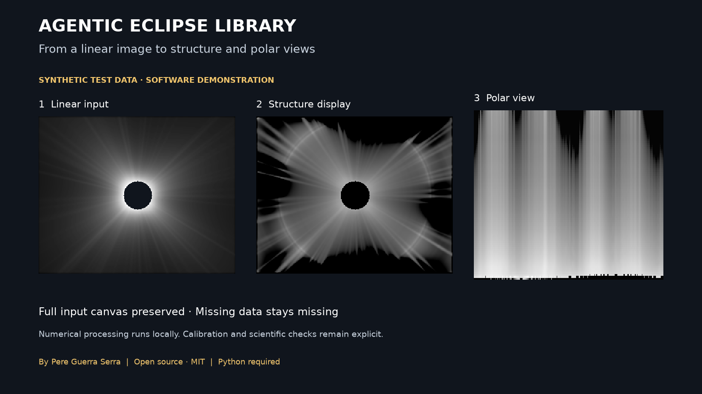

# Agentic Eclipse Library for Claude

Process total solar eclipse photographs with seven guided workflows: get started, calibrate and stack,
create corona filter layers, investigate artefacts, make polar views and motion analyses, compare
observations with coronagraphs, and take a whole case to an editable master the photographer accepts
(contributed by Raúl Hussein). Created by Pere Guerra Serra. MIT licensed.

This plugin bundles the AEL 1.3.2 Python processing engine, its known-truth tests, recipe templates and
practical documentation. It runs on your computer with Python 3.10 or later. Claude plans the work and
explains the results; AEL performs the numerical processing.

## Start

Install this plugin from Claude's plugin directory. (The repository's own marketplace installs the full
research edition instead: the same engine plus the original project's longer skills, mostly in Catalan.)
Then ask, in your language:

- Help me process my total solar eclipse photos while preserving the original files.
- Inspect the rings in my corona image and find which processing stage caused them.
- Show me a clearly labelled synthetic demonstration before I use my own photos.

Follow [setup and operating instructions](docs/USAGE.md). Installing the plugin does not install Python
or Python dependencies. The setup checks what is available before proposing a change.

## Outputs and limits

AEL can write linear stacks, validity and coverage maps, filter layers, 16-bit layered Photoshop files,
polar views, motion check sheets and animations. A photograph is not an absolute brightness measurement.
Calibration, registration, geometry and any spatial cloud correction require measured inputs; AEL does
not infer all of these from a folder of RAWs. Photoshop itself is optional.

Known limitations in 1.3.2 include bands near data boundaries in ACHF/WOW and possible fine-detail sign
inversion in WOW bilateral. See [field lessons](docs/FIELD_LESSONS.md). Passing the bundled tests does
not validate a new astronomical observation. Missing data stays missing. Synthetic examples are labelled
and must never be used as pixels in an observed image.

## What this plugin runs, fetches and sends

- **Runs locally.** The skills run the bundled Python source through `scripts/run_ael.py`. It reads the
  files selected for the task and writes new output folders; it refuses to write into an existing one.
- **Fetches, only when needed.** Installing the Python dependencies uses pip, which normally downloads
  them from PyPI: NumPy, SciPy, OpenCV, Pillow, tifffile and imageio, plus rawpy and Astropy for RAW and
  FITS, and psd-tools for Photoshop files. The launcher itself never installs packages. Public coronagraph
  data (K-Cor from the Mauna Loa Solar Observatory, SOHO/LASCO from the Naval Research Laboratory, SDO/AIA
  from Stanford's JSOC) is downloaded only after you approve it, with its source, purpose and size stated
  first. Astropy may fetch Earth-orientation tables when network access is enabled.
- **Sends nothing.** No MCP server, no hooks, no telemetry, no paid model calls, no credential reader and
  no uploader. Claude's own data policy applies to what enters the conversation: filenames, prompts,
  previews and tool outputs. Publishing photographs, uploading data or contacting anyone requires your
  authorisation for that action.

The original project's research archive stays in the
[source repository](https://github.com/PeterWar/Agentic-Eclipse-Library); this plugin does not install it.

Support: [GitHub Issues](https://github.com/PeterWar/Agentic-Eclipse-Library/issues).
[Privacy policy](https://github.com/PeterWar/Agentic-Eclipse-Library/blob/main/docs/CODEX_PLUGIN_PRIVACY.md)
(it covers this plugin too) and
[licence and terms](https://github.com/PeterWar/Agentic-Eclipse-Library/blob/main/docs/CODEX_PLUGIN_TERMS.md).
Optional credit: Processed with Agentic Eclipse Library by Pere Guerra.
