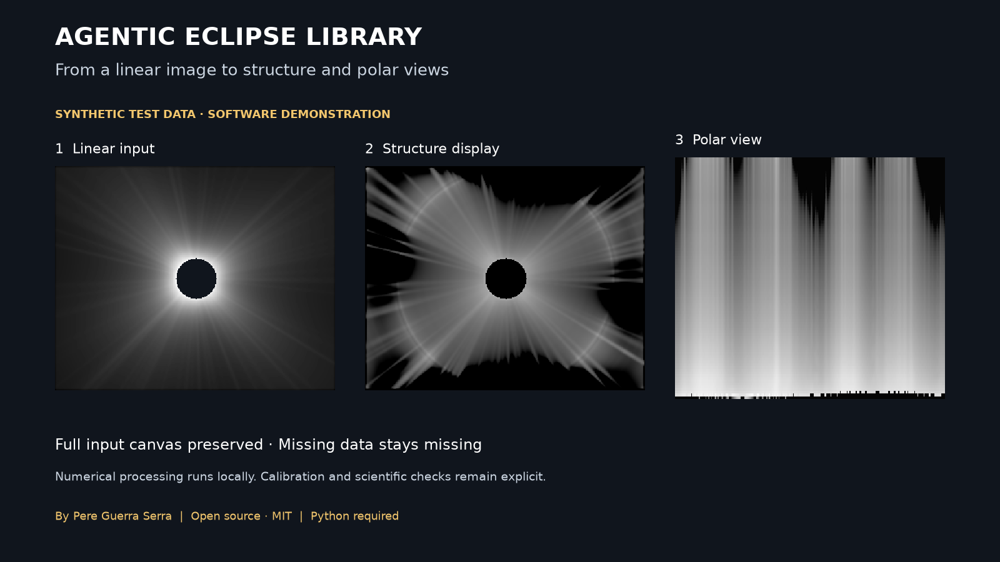

# Agentic Eclipse Library for Claude

Process total solar eclipse photographs with seven guided workflows: get started, calibrate and stack,
create corona filter layers, investigate artefacts, make polar views and motion analyses, compare
observations with coronagraphs, and take a whole case to an editable master the photographer accepts
(contributed by Raúl Hussein). Created by Pere Guerra Serra. MIT licensed.

This plugin holds the workflows, recipe templates and practical documentation; it contains no program files. The
numerical processing is done by the AEL 1.4.2 Python package, which runs on your computer with Python 3.10
or later. Claude plans the work and explains the results; AEL performs the numerical processing.

## Start

Install this plugin from Claude's plugin directory. (The repository's own marketplace installs the full
research edition instead: the engine itself plus the original project's longer skills, mostly in Catalan.)
Then ask, in your language:

- Help me process my total solar eclipse photos while preserving the original files.
- Inspect the rings in my corona image and find which processing stage caused them.
- Show me a clearly labelled synthetic demonstration before I use my own photos.

Follow [setup and operating instructions](docs/USAGE.md). Installing the plugin installs no software. Claude
first checks what your Python environment already has; if AEL 1.4.2 is missing, it asks before installing it.

## Outputs and limits

AEL can write linear stacks, validity and coverage maps, filter layers, 16-bit layered Photoshop files,
polar views, motion check sheets and animations. A photograph is not an absolute brightness measurement.
Calibration, registration, geometry and any spatial cloud correction require measured inputs; AEL does
not infer all of these from a folder of RAWs. Photoshop itself is optional.

Known limitations in 1.4.2 include bands near data boundaries in ACHF/WOW, some fine-detail sign inversion
in the worst sectors of the default edge-aware WOW, and rings of the plain WOW next to a lunar limb that the data reach; of the
layers new in 1.4.2, a light ring of NAFE next to the lunar limb and the copies at ±Δθ of the Larson–Sekanina layers. See [field lessons](docs/FIELD_LESSONS.md). Passing the package's
known-truth tests does not validate a new astronomical observation. Missing data stays missing. Synthetic examples
are labelled and must never be used as pixels in an observed image.

## What this plugin runs, fetches and sends

- **No program files.** Markdown instructions, JSON recipe templates and images only. Claude may write short
  Python scripts in your workspace that call AEL, as the setup instructions show.
- **Runs locally.** The skills run the AEL 1.4.2 package with `python -m ael` in the Python environment you
  choose. It reads the files selected for the task and writes new output folders; Claude checks that each output
  folder is new before a command writes to it. To write MP4 animations, AEL runs ffmpeg if it is already installed.
- **Fetches, only with your approval.** Installing AEL downloads its wheel (about 250 KB) from this project's
  GitHub release v1.4.2; pip refuses it unless its SHA-256 fingerprint matches the one written in the setup
  instructions. pip normally downloads the dependencies from PyPI: NumPy, SciPy, OpenCV, Pillow, tifffile and
  imageio, plus rawpy and Astropy for RAW and FITS, and psd-tools for Photoshop files. AEL itself has no network
  code. Public coronagraph data (K-Cor from the Mauna Loa Solar Observatory, SOHO/LASCO from the Naval Research
  Laboratory, SDO/AIA from Stanford's JSOC) is downloaded only after you approve it, with its source, purpose and
  size stated first. Astropy may fetch Earth-orientation tables when network access is enabled. Any other
  package a task needs, such as sunpy for some LASCO files, is installed only with your approval.
- **Sends nothing.** No MCP server, no hooks, no telemetry, no paid model calls, no credential reader and
  no uploader. Claude's own data policy applies to what enters the conversation: filenames, prompts,
  previews and tool outputs. Publishing photographs, uploading data or contacting anyone requires your
  authorisation for that action.

The original project's research archive stays in the
[source repository](https://github.com/PeterWar/Agentic-Eclipse-Library); this plugin does not install it.

Support: [GitHub Issues](https://github.com/PeterWar/Agentic-Eclipse-Library/issues).
[Privacy policy](https://github.com/PeterWar/Agentic-Eclipse-Library/blob/main/docs/CODEX_PLUGIN_PRIVACY.md)
(it covers this plugin too) and
[licence and terms](https://github.com/PeterWar/Agentic-Eclipse-Library/blob/main/docs/CODEX_PLUGIN_TERMS.md).
Optional credit: Processed with Agentic Eclipse Library by Pere Guerra.
